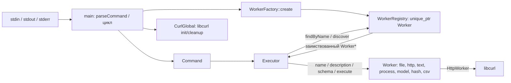

# Архитектура SADER

**IMPLEMENTED.** Текущая архитектура синхронного интерактивного приложения основана на [main.cpp](../src/main.cpp), [Command.h](../include/sader/Command.h), [Executor.cpp](../src/Executor.cpp), [WorkerRegistry.cpp](../src/WorkerRegistry.cpp) и [WorkerFactory.cpp](../src/WorkerFactory.cpp).



## Компоненты и поток команд

- [Worker.h](../include/sader/Worker.h) задаёт `name()`, `description()`, `schema()` и `execute()`; последние два имеют реализацию по умолчанию, бросающую `std::runtime_error`.
- [WorkerFactory.h](../include/sader/WorkerFactory.h) выбирает конкретный класс по `WorkersName` и возвращает `std::unique_ptr<Worker>`. Список жёстко задан в [WorkerFactory.cpp](../src/WorkerFactory.cpp).
- `WorkerRegistry::registerWorker` принимает владение `unique_ptr`, отвергает `nullptr` и повторное имя; `findByName` сравнивает имена на точное равенство, `discover` ищет подстроку **только в описании**, с учётом регистра. Порядок результатов соответствует регистрации. В [WorkerRegistry.h](../include/sader/WorkerRegistry.h) объявлена `const`-перегрузка `findByName`, но в `.cpp` определена лишь неконстантная. `Executor` хранит неконстантную ссылку и использует определённую перегрузку; вызов через `const WorkerRegistry` остаётся без определения.
- `parseCommand` определена в [main.cpp](../src/main.cpp), отдельного `Parser`-класса нет. Она распознаёт префиксы `DISCOVER `, `DESCRIBE `, `CALL `; `EXIT`/`QUIT` перехватываются до парсинга. `Command` хранит `CommandType`, имя/запрос в `argument` и карту строковых `arguments`.
- [Executor.cpp](../src/Executor.cpp) печатает результат напрямую. `DISCOVER` выводит имена и описания, `DESCRIBE` запрашивает `schema()`, `CALL` вызывает `execute(args)` и печатает `output` или `error`. Для неизвестного имени обе последние команды печатают «Воркер не найден». Общего слоя валидации схемы в `Executor` нет.

### Последовательность `CALL`

```mermaid
sequenceDiagram
    actor User
    participant Main as main / parseCommand
    participant Executor
    participant Registry as WorkerRegistry
    participant Worker
    User->>Main: CALL text operation=length text=hello
    Main->>Main: split по пробелам; key=value в Command.arguments
    Main->>Executor: execute(Command)
    Executor->>Registry: findByName("text")
    Registry-->>Executor: Worker* или nullptr
    alt Worker найден
        Executor->>Worker: execute(Arguments)
        Worker-->>Executor: Result
        Executor-->>User: Успех + output / Ошибка + error
    else Worker не найден
        Executor-->>User: Воркер не найден
    end
    Note over Main: Исключения std::exception перехватывает цикл main и печатает ERROR в stderr
```

## Владение и ресурсы

`CurlGlobal` создаётся до реестра в `main()` и вызывает `curl_global_init` / `curl_global_cleanup` через RAII ([CurlGlobal.h](../include/sader/CurlGlobal.h)). Фабрика возвращает владеющий `unique_ptr`; реестр хранит `vector<unique_ptr<Worker>>`. `findByName` и `discover` выдают невладеющие указатели: их нельзя использовать после разрушения Worker/реестра. `Executor` хранит `WorkerRegistry&` и обязан жить не дольше реестра. В `main()` порядок локальных переменных гарантирует уничтожение `Executor`, затем реестра с Worker, затем `CurlGlobal`.

Для HTTP-дескриптора используется `unique_ptr<CURL, CurlDeleter>` ([HttpWorker.cpp](../workers/http/HttpWorker.cpp)); файловый поток — `std::ifstream` ([FileWorker.cpp](../workers/file/FileWorker.cpp)); `PipeGuard` закрывает `popen`-канал через `pclose` ([ProcessWorker.cpp](../workers/process/ProcessWorker.cpp)). Конструкторы/деструкторы ряда Worker пишут в stdout, поэтому сообщение может появиться до приглашения CLI и при выходе.

## Границы реализации и вопросы

**TESTED (наличие исходников тестов):** [реестр](../tests/test_worker_registry.cpp), [фабрика](../tests/testWorkerFabric.cpp), [HTTP](../tests/HttpWorkerTest.cpp), [файл](../tests/FileWorkerTest.cpp), [процесс](../tests/test_process_worker.cpp), [модель](../workers/model/ModelWorkerTest.cpp). Тесты `Executor`/парсера в дереве не найдены; успешный запуск перечисленного здесь не заявляется.

**PLANNED:** ThreadPool и асинхронное выполнение, Docker и GitHub Actions CI. До реализации требуется согласовать жизненный цикл задач относительно `WorkerRegistry`, потокобезопасность Worker и libcurl, порядок вывода, отмену и обработку исключений; публичный контракт пока не менять без согласования.

**UNKNOWN / вопросы к команде:**

1. Нужна ли `const WorkerRegistry::findByName` и как обеспечить её определение и проверку вызова через `const WorkerRegistry`?
2. Нужна ли единая проверка `Schema` перед `execute`, если часть Worker не предоставляет схему и проверяет аргументы по-разному?
3. Какой контракт ошибок и вывода нужен для асинхронных вызовов вместо текущей печати из `Executor`?
4. Как обеспечить корректность и изоляцию `ProcessWorker`: аргументы собираются в shell-строку, вывод склеивается в строку вида JSON без экранирования, `WEXITSTATUS` применяется без проверки статуса?
5. Какой объём регрессионных проверок и поддерживаемых платформ обязателен перед CI и Docker-публикацией? Успешная сборка на Linux/macOS здесь не подтверждена.
